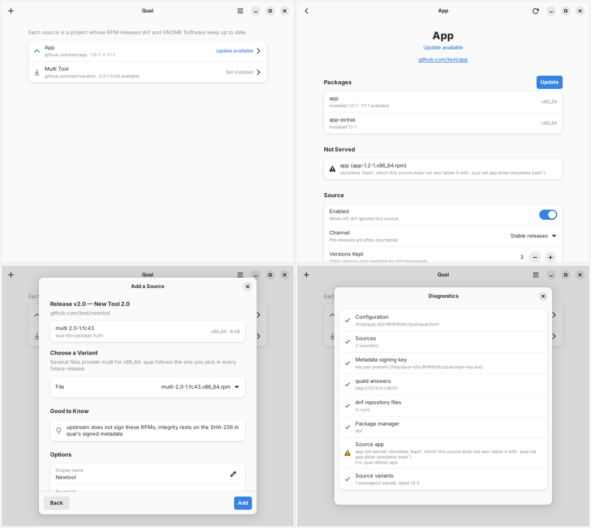

<p align="center"></p>

# Quai

**Keep RPMs published as GitHub, GitLab or Forgejo releases up to date — through dnf.**

Many tools (Orca, Cursor-like editors, terminals, AI agents…) ship their Fedora build only as a
`.rpm` attached to a release. Installed by hand, dnf records it as `@commandline` and it never
updates again. Quai turns each such project into a small **signed dnf repository served on your
own machine**, so dnf, GNOME Software, Discover, dnf-automatic and rpm-ostree install, update and
roll it back like any other Fedora package. Its window is native on both Fedora desktops:
libadwaita on GNOME, Kirigami on KDE Plasma.

```console
$ quai preview stablyai/orca      # what would be added, no root needed
$ sudo quai add stablyai/orca     # track it: dnf now sees updates of orca-ide
$ sudo dnf upgrade                # …or GNOME Software, Discover, or dnf-automatic
```



## How it works

```
 quai-gtk ┐
 quai-kde ┴─pkexec──▶ quai (CLI, root) ──writes──▶ /etc/quai/sources.d/<id>.toml
                                                   /etc/yum.repos.d/quai-<id>.repo
                                                              │ read by
 dnf5 · rpm-ostree · Software · Discover ──HTTP 127.0.0.1:741──▶ quaid ──API + Range──▶ forge
                         ▲                                     │
                         └──── 302 to the forge's CDN ◀────────┘  (SHA-256 verified by dnf)
```

* **quaid** is socket-activated by systemd: nothing runs until dnf asks for `repomd.xml`, and it
  exits after two idle minutes. It lists the project's releases (with ETags, so an unchanged
  project costs no API budget), reads **only the header** of each RPM with HTTP range requests,
  generates `primary`/`filelists`/`other` metadata identical in substance to `createrepo_c`'s, and
  signs `repomd.xml` with a key generated on your machine.
* **Packages are never stored.** dnf downloads them from the forge's CDN (quaid answers with a
  302) and checks the SHA-256 written in the signed metadata. GitHub publishes asset digests; for
  GitLab and Forgejo quaid downloads each version once to compute it.
* The **CLI** is the only thing that writes system configuration. Both graphical frontends run it
  through polkit and show its JSON output, so they share every rule and message.

## One app, two native windows

No toolkit is native on both GNOME and Plasma, so Quai has two thin frontends over the same CLI:
`quai-gtk` (GTK 4 / libadwaita) and `quai-kde` (Kirigami, QML on Qt 6 through
[cxx-qt](https://github.com/KDAB/cxx-qt)). The user still sees a single app:

* **One launcher.** The `quai-gui` package owns the only `.desktop` file and AppStream component;
  it runs `quai gui`, which opens `quai-kde` when `$XDG_CURRENT_DESKTOP` contains `KDE` and
  `quai-gtk` otherwise, falling back to whichever is installed (`quai gui --frontend gtk|kde` or
  `QUAI_GUI=` pins one). Both windows use the app id `io.github.it_yohan.Quai`, so the panel shows
  the same icon.
* **The right one is installed.** `quai` recommends `quai-gui` on a desktop, and `quai-gui`
  recommends `quai-kde` if `plasma-workspace` is installed, `quai-gtk` otherwise (both with two
  desktops). [`tests/packaging/weak-deps.sh`](tests/packaging/weak-deps.sh) checks these cases
  with dnf.

## Install

Quai targets Fedora 41+ (dnf5) and Fedora Atomic desktops.

From source (Rust ≥ 1.82, `gtk4-devel`, `libadwaita-devel`, `qt6-qtbase-devel`,
`qt6-qtdeclarative-devel`, `gcc-c++`, `gettext`, `appstream`; `kf6-kirigami` and
`kf6-qqc2-desktop-style` at run time):

```console
$ make                     # or: make FRONTENDS=gtk (no Qt), make FRONTENDS= (headless)
$ sudo make install        # programs, translations, man pages, bash/zsh/fish completions
$ sudo systemd-sysusers && sudo systemctl daemon-reload
$ sudo quai setup          # signing key, /etc/quai, enables quaid.socket
```

As an RPM: `make dist` produces the source and vendored-crates tarballs for
[`packaging/quai.spec`](packaging/quai.spec), ready for COPR. Each binary subpackage's
`License:` covers the crates linked into it;
[`packaging/licenses.py`](packaging/licenses.py) recomputes them after a dependency change.

## Languages

Quai speaks the user's language everywhere: `quai` messages and `--help`, both windows, the
menu entry, the AppStream page and the password prompt. English and French ship today.

Everything goes through one gettext catalogue, `po/quai.pot`, so a new language is one file
and no code: copy `po/quai.pot` to `po/<lang>.po` (or let Weblate create it), translate, add
`<lang>` to `po/LINGUAS`. Plural forms, right-to-left layout (Qt and GTK take it from the
language) and reordered placeholders are handled; `make check-po` rejects a translation that
drops a `{placeholder}`.

For developers: wrap user-facing text in the functions of
[`quai-i18n`](crates/quai-i18n/src/lib.rs) (`tr`, `trf`, `trn`, `trc`; the same names from QML
through the `I18n` singleton), then `make update-po`. CI fails when `po/quai.pot` is stale.
Messages quaid records while checking (a source's last error) follow the system language
(`/etc/locale.conf`); everything else follows the user's.

## Use it

| Command | Root | What it does |
| --- | --- | --- |
| `quai preview <spec>` | no | Shows what `add` would do: packages, versions, warnings |
| `quai add <spec> [--install]` | yes | Starts tracking a project; `--install` installs it now |
| `quai install <id>` | yes | Installs the packages of a tracked source |
| `quai status [id]` / `quai list` | no | Installed versus available versions, errors, excluded packages |
| `quai refresh [id]` | no | Asks quaid to check the forge now (at most every 30 s) |
| `quai upgrade [id]` | yes | Targeted `dnf upgrade` (`rpm-ostree upgrade` on Atomic) |
| `quai enable` / `disable <id>` | yes | Suspends a source without removing it |
| `quai set <id> <key> <value>` | yes | `name`, `channel`, `asset-pattern`, `keep-versions`, `allow-package`, `allow-obsoletes`, `package-gpgkey`… |
| `quai remove <id> [--uninstall]` | yes | Stops tracking, optionally uninstalls |
| `quai export` / `quai import <file>` | import | All sources in one TOML file, for your dotfiles |
| `quai token set --host github.com` | yes | Token read from stdin: 5,000 GitHub API requests/hour instead of 60 |
| `quai config [key value]` | set | `listen`, `check-interval-mins`, `keep-versions`, `metadata-expire`, `sign-metadata` |
| `quai doctor` | no | Checks everything and says how to fix it |

A `<spec>` is `owner/repo` (GitHub), a project URL, or `codeberg:owner/repo`,
`gitlab:group/project`, `forgejo:git.example.org/owner/repo`. Every command accepts `--json`.

When a release ships several RPMs for the same package and architecture (an `el9` and an `fc43`
build, say), `add` asks you to choose with `--asset-pattern`; `preview` prints a ready-made
pattern for each file, and both apps offer them in a drop-down.

The graphical app (**Quai** in your app grid) does the same: add a project, see what it ships
first, toggle channel and versions kept, update, remove.

## Security model

You trust the upstream maintainer exactly as much as when you install their `.rpm` by hand: its
scriptlets run as root. Quai guarantees the rest.

| Threat | Mitigation |
| --- | --- |
| A local process impersonates quaid | Privileged port held by systemd, and `repomd.xml` signed with an Ed25519 key readable only by root and the `quai` group (`repo_gpgcheck=1`) |
| A file is swapped on the CDN after publication | SHA-256 in the signed metadata, verified by dnf |
| A source suddenly ships `glibc` | `includepkgs` limited to the names seen when the source was added; anything new is excluded and reported until `quai set <id> allow-package <name>` |
| A package declares `Obsoletes: firefox` | Excluded unless the obsoleted package belongs to the source or is explicitly allowed |
| Two sources fight over one package name | Refused when adding |
| Forge token leak | `0640 root:quai`, sent only to the API host it was saved for |
| A non-admin user adds a source | Writes need root (sudo, or polkit `auth_admin_keep`) |

If upstream signs its RPMs, `quai set <id> package-gpgkey https://…` turns on `gpgcheck=1`.

## Files

| Path | Content |
| --- | --- |
| `/etc/quai/quai.toml` | Global settings |
| `/etc/quai/sources.d/<id>.toml` | One tracked project; edit by hand then `quai sync` |
| `/etc/quai/repo-key.asc`, `/etc/quai/private/` | Signing key pair, tokens |
| `/etc/yum.repos.d/quai-<id>.repo` | Generated; marked `# Managed by quai` |
| `/var/cache/quai/` | RPM headers, forge answers, generated metadata (safe to delete) |

Behind a corporate proxy, give quaid the variable with `sudo systemctl edit quaid.service`:
`[Service]` / `Environment=HTTPS_PROXY=http://proxy:3128`.

## Development

```console
$ cargo test --workspace          # unit tests + RPM reader checked against rpm and createrepo_c
$ make fixtures                   # rebuild tests/fixtures/rpms with rpmbuild
$ sudo make e2e                   # mock forge → quaid → real dnf, in a throw-away installroot
$ sudo QUAI_E2E_KDE=stub make e2e # …then drive the Kirigami window (stub, or `system` Kirigami)
$ sudo tests/packaging/weak-deps.sh   # which frontend dnf installs on each desktop
$ make lint                       # rustfmt + clippy -D warnings
$ make check-po                   # translation template up to date, catalogues valid
```

The end-to-end test builds RPMs, serves them from a GitHub look-alike
([`tests/e2e/mock_forge.py`](tests/e2e/mock_forge.py)) and drives the real CLI, daemon and dnf
through add, install via redirect, new release, upgrade, downgrade, signature tampering, the
allow-list and `Obsoletes` guards, disable/enable, export/import and doctor, then checks that
the CLI answers in French when a French locale is installed. With
`QUAI_E2E_KDE`, it then runs the real `quai-kde` pages offscreen
([`crates/quai-kde/tests/ui-test.qml`](crates/quai-kde/tests/ui-test.qml)): source list, detail
page, preview with variant selection, preferences, diagnostics, about and refresh, failing on any
QML error, in English and again in French. `stub` uses a minimal Kirigami look-alike for machines without KDE Frameworks; CI uses
the real one on Fedora.

Environment variables for development and tests:

| Variable | Effect |
| --- | --- |
| `QUAI_CONFIG_DIR`, `QUAI_REPOS_DIR`, `QUAI_CACHE_DIR`, `QUAI_SYSTEMD_DIR` | Relocate `/etc/quai`, `/etc/yum.repos.d`, `/var/cache/quai`, `/etc/systemd/system` |
| `QUAI_DNF_ARGS` | Extra arguments for every dnf call (e.g. `--installroot=…`) |
| `QUAI_RPM_ROOT` | `rpm --root` for installed-version queries |
| `QUAI_API_URL` | Point every forge at a test server |
| `QUAI_SKIP_ROOT_CHECK` | Skip the root check when paths are writable |
| `QUAID_FORCE_COOLDOWN_SECS` | Minimum delay between forced refreshes (default 30) |
| `QUAI_BIN`, `QUAI_GUI_NO_PKEXEC` | Which `quai` the frontends run, and without pkexec |
| `QUAI_GUI` | Frontend opened by `quai gui` (`gtk` or `kde`) |
| `QUAI_KDE_MAIN` | QML file loaded by `quai-kde` instead of the built-in one (tests) |
| `QUAI_LOCALEDIR` | Where the compiled catalogues are (default `/usr/share/locale`; `make` puts them in `target/generated/locale`) |
| `QUAI_LOG`, `QUAID_LOG` | Log filter (`debug`, `info`…) |

Layout: `crates/quai-core` (engine: forges, RPM header reader, repodata, signing),
`crates/quaid` (HTTP gateway), `crates/quai-cli` (`quai`), `crates/quai-gtk` (GNOME app),
`crates/quai-kde` (Plasma app), `crates/quai-types` (JSON contract between the CLI and the apps),
`crates/quai-i18n` (translations), `po/` (catalogues), `data/` (systemd, polkit, desktop,
AppStream, icons; `.in` files are translated at build time), `packaging/` (RPM spec).

## Roadmap

* AppStream metadata generated from the package's `.desktop` file, for a real app page in GNOME
  Software.
* Translated man pages (they are generated in English today).
* Private repositories (quaid relays the download with the token); verification of GitHub
  artifact attestations when upstream publishes them.
* A public COPR.

## License

Apache-2.0. See [LICENSE](LICENSE).
